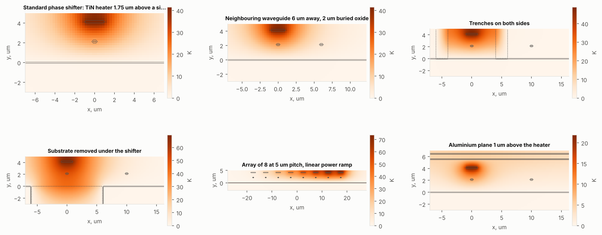

# HeatPhase

A two-dimensional heat conduction solver for thermo-optic phase shifters in Rust, with no dependencies: finite volumes on a chip cross-section, banded Cholesky and conjugate-gradient solvers, step response, power for a phase shift of pi, and the thermal crosstalk between neighbouring waveguides that limits dense phased arrays.

The repository is also a library of 80 cross-sections: phase shifters, pairs at different pitches, trenches and undercuts, arrays, metal nearby. Each file states in its first lines what it shows and what it is checked against, and carries the result as machine-checked expectations. Every cross-section is solved a second time by an independent SciPy implementation.

## What is inside

| Part | Where (`engine/src`) | Content |
|---|---|---|
| Mesh | `thermal/mesh.rs`, `material.rs` | uniform cells, painted rectangles, six built-in materials and custom ones |
| Matrix | `thermal/system.rs` | harmonic-mean conductances, heat sink, adiabatic or convective top, heat balance |
| Linear algebra | `linalg/` | symmetric banded Cholesky; preconditioned conjugate gradients |
| Steady state | `thermal/steady.rs` | heater sources, probes, one factorisation for many heaters |
| Step response | `thermal/transient.rs` | implicit Euler, time to 63%, 10 to 90% rise |
| Closed forms | `analytic.rs` | layered stack, line heater on a slab, slab time constant, power for pi |
| Files | `design/` | text format, analysis, eleven kinds of expectation |
| Library | `cases/*.heat` | 80 cross-sections in ten families |
| Reference | `src/heatphase/reference.py` | the same meshes assembled and solved independently with SciPy |
| Results | `reports/cases/*.json`, `reports/figures/cases/*.png` | responses, checks, temperature map and profile or step response |

51 Rust tests; pytest runs every cross-section of the library as its own test.

## Results

80 cross-sections, 1.27 million cells, 1,294 checks, all passing. Full tables in `reports/report.md`.

| Family | Sections | What is verified |
|---|---|---|
| Layered stacks | 6 | the one-dimensional result, flux times the sum of thickness over conductivity, to 1e-9 |
| Line heater | 5 | P / (pi k) ln coth(pi x / 4d) within 0.2% from half a thickness to three thicknesses away |
| Phase shifter | 18 | heater width, height, buried oxide, cladding, a silicon slab, misalignment |
| Crosstalk | 10 | neighbour response against pitch for two oxide thicknesses |
| Trenches and undercut | 8 | efficiency, crosstalk and speed of eight isolation schemes |
| Arrays | 6 | 8 and 16 channels, every probe against every heater (the bulk of the checks) |
| Top surface | 3 | still air, forced air, a cooled top |
| Step response | 8 | slab against its series within 3%; shifters by independent time stepping |
| Mesh and solver | 12 | three meshes, conjugate gradients against Cholesky, window and substrate depth |
| Metal | 4 | a plane, a wire, a thermal via, heating in the silicon layer |

Agreement between the Rust solver and the SciPy reference over the whole library: responses to 1e-8, time constants to 1e-8, the whole field to 4e-7 of its peak (the printed precision).



## Five things the solver makes visible

1. **The standard shifter needs 24 mW for pi and settles in 9 us.** A 2 um TiN heater 1.75 um above a waveguide on 2 um of buried oxide raises the core by 172 K per mW/um.
2. **Efficiency and speed trade one for one.** With 1, 2 and 3 um of buried oxide the power for pi is 38, 24 and 19 mW and the time constant 6.3, 9.3 and 12.6 us: the product stays between 226 and 240 nJ.
3. **Crosstalk decays exponentially with pitch, on the scale of the oxide thickness.** 46% at 4 um, 26% at 6, 7.8% at 10, 0.5% at 20, with a fitted decay length of 3.5 um against 3.2 um (2 d / pi) for 5 um of oxide over a perfect sink. An eight-channel array at 5 um pitch has 35% nearest-neighbour crosstalk; with alternate heaters on, the unheated channels sit at 63% of the heated ones.
4. **A trench cuts crosstalk more than it saves power; an undercut does the opposite.** At 10 um pitch a trench to the substrate takes crosstalk from 7.8% to 1.1% and the power for pi from 24.2 to 21.6 mW. Removing the substrate under the shifter brings the power down to 8.4 mW but raises crosstalk to 9.1% and the time constant from 9.6 to 41 us.
5. **Air above the chip does not matter.** With a film coefficient of 10 W/(m2 K) 0.003% of the heat leaves through the top; with 1000 it is 0.3%.

## Reading the numbers

- Two dimensions. The cross-section is taken as infinitely long. Heat spreading along the waveguide at the ends of a real heater, and into bond pads and wires, is ignored; short heaters are less efficient than these numbers say.
- The heat sink is the bottom of the modelled substrate, 10 um of silicon by default. Varying it from 2 to 20 um changes the response by 1.3% or less, because silicon conducts a hundred times better than oxide, but a real chip on a poor mount sits on an additional thermal resistance that raises everything uniformly.
- Bulk, temperature-independent conductivities. Thin silicon layers conduct less than bulk (roughly half at 220 nm), thin-film oxides vary with deposition, and silicon's conductivity falls with temperature. The single silicon slab case in the library uses the bulk value.
- The power for pi uses the temperature of the core and one thermo-optic coefficient. The overlap of the optical mode with the oxide, whose coefficient is twenty times smaller, is not accounted for; real values are a few percent higher.
- The "suspended" cross-section (undercut with side trenches) gives 0.8 mW for pi because in two dimensions nothing but air holds the bridge. A real suspended shifter is anchored along its length; treat the number as a bound.
- Step responses use implicit Euler with steps of about a twentieth of the time constant and read a few percent long (2% on the slab test). Rankings and ratios are reliable.
- Mesh: 250 nm cells differ from 125 nm cells by 0.3% in the response; 500 nm cells by 5%.
- The fitted crosstalk decay length is longer than the slab formula because the substrate is not a perfect sink: far from the heater the residual heat travels in the silicon. Beyond 20 um the decay is slower than the fit.
- The expectations in the files and the recomputation in the report come from the same independent implementation of the same scheme, plus the closed forms. They verify the solver. There is no comparison with measured devices in this repository.
- The per-section result files and figures are generated by `make run`; they are stored so that the library can be browsed without building anything.

## Run it

```
pip install -e ".[dev]"
make build      # cargo build --release
make test       # cargo test, then pytest (every cross-section is a test)
make run        # solves the library, writes reports/ (about a minute)
```

One cross-section:

```
engine/target/release/heatphase check cases/shifter_standard.heat
python scripts/solve.py cases/trench_both.heat
python scripts/plot_section.py cases/trench_undercut.heat field.png
python scripts/crosstalk_matrix.py cases/array_one_on.heat
python scripts/compare_reference.py cases/array_ramp.heat
```

A cross-section file:

```
# The reference device of the library.
title Standard phase shifter
grid dx=0.25 dy=0.25
window width=60 ymin=-10 ymax=5
layer si -10 0
layer sio2 0 5
rect si -0.25 0.25 2 2.25
rect tin -1 1 4 4.25
heater h xmin=-1 xmax=1 ymin=4 ymax=4.25 power=0.1
probe wg xmin=-0.25 xmax=0.25 ymin=2 ymax=2.25
transient heater=h dt=0.5 steps=500

expect pi_power wg h 24.2464 1e-4
expect balance 1e-9
```

From Rust:

```rust
use heatphase::design::{analyse::analyse, parse::parse};

let spec = parse(&std::fs::read_to_string("cases/pitch_box2_p10.heat")?)?;
let a = analyse(&spec)?;
println!("{:.1} mW for pi, crosstalk {:.1}%", a.pi_power[0][0], 100.0 * a.response[1][0] / a.response[0][0]);
```

## Layout

```
engine/src/          thermal (material, mesh, system, steady, transient), linalg, analytic, design, command line binary
engine/tests/        integration tests, one file per subject
engine/examples/     three short programs
cases/               80 cross-sections, each with its description and expectations
src/heatphase/       Python driver, independent reference, comparison, studies, report and figures
docs/                file reference, method and validation
reports/             report, validation table, per-section results and figures
```

## Author

Amir Masominia. PhD in physics (Université Paris-Saclay); postdoctoral researcher working on machine-learning surrogate models, numerical simulation and automated measurement pipelines.

MIT licence.
